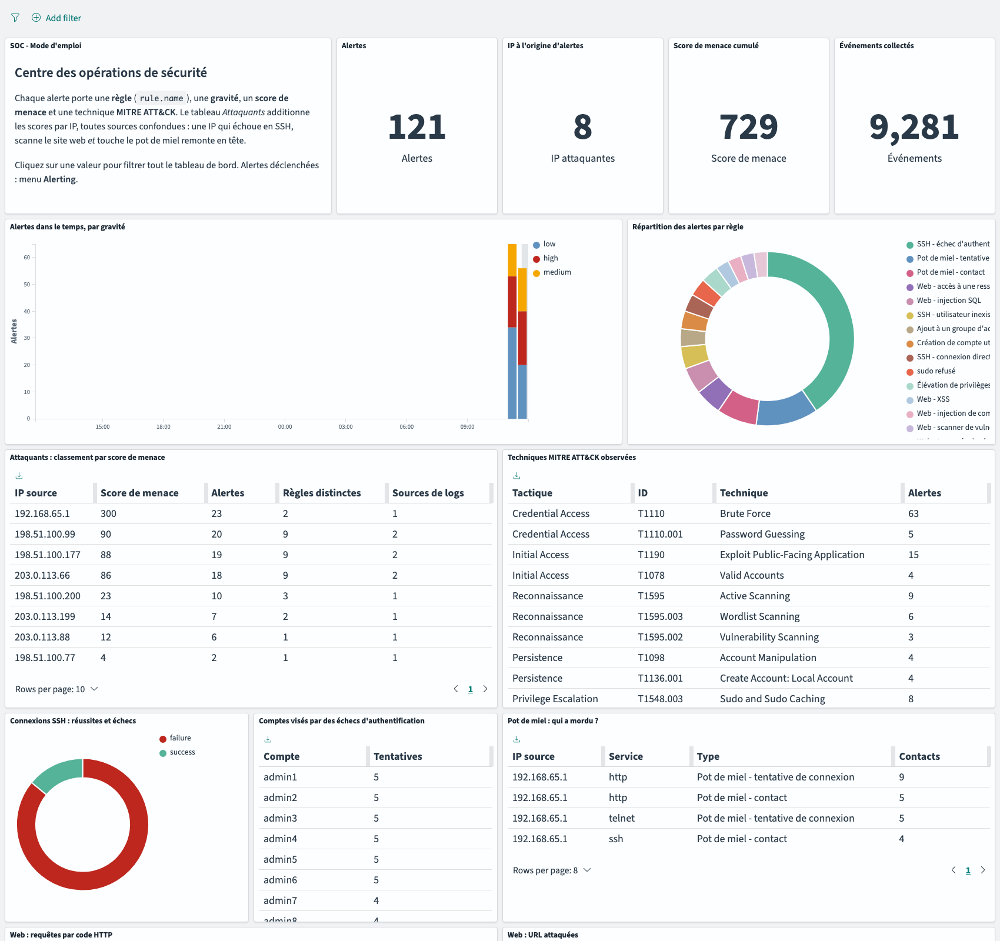

# Security Operation Center

Un SOC complet qui tient dans un `docker compose up` : il collecte les journaux, y détecte les
attaques, les relie entre elles et vous prévient.



```
 Serveurs, équipements ──syslog :9000──┐
 Conteneurs Docker ─────docker.sock────┼─► Vector ──► OpenSearch (2 nœuds) ──► Dashboards
 Pot de miel ───────────────────────────┘   détection        alertes            tableau de bord
 (faux services)                            score, MITRE     notifications
```

| Composant | Rôle |
|---|---|
| **Vector** | collecte, normalise (champs de type ECS) et applique les règles de détection |
| **OpenSearch** | stocke, recherche, et exécute les moniteurs d'alerte chaque minute |
| **OpenSearch Dashboards** | tableau de bord, exploration, gestion des alertes |
| **Pot de miel** | faux services exposés : tout contact est une attaque certaine |

## Démarrage

Prérequis : Docker avec Compose, et environ **4 Go de mémoire libre** pour Docker.

```bash
./soc demarrer
```

Au premier lancement, la commande crée `.env` avec trois mots de passe aléatoires, démarre les
services puis provisionne tout seule : comptes, index, rétention, alertes, tableau de bord.
Comptez deux à trois minutes.

```bash
./soc etat       # services, adresses, identifiants, alertes en cours
./soc ouvrir     # ouvre le tableau de bord
./soc simuler    # rejoue une attaque factice pour voir le SOC réagir
```

| Compte | Usage | Mot de passe (dans `.env`) |
|---|---|---|
| `admin` | administration | `OPENSEARCH_INITIAL_ADMIN_PASSWORD` |
| `analyste` | consultation quotidienne, **lecture seule** | `ANALYST_PASSWORD` |
| `vector` | compte de service, écriture dans `soc-*` uniquement | `VECTOR_PASSWORD` |

<details>
<summary>Windows (WSL via Docker Desktop)</summary>

Configurez `vm.max_map_count` dans la distribution WSL de Docker Desktop :

    wsl -d docker-desktop
    sysctl -w vm.max_map_count=262144
</details>

## Brancher vos sources de journaux

**Conteneurs Docker** — rien à faire : tous les conteneurs de la machine sont collectés.
Les journaux d'accès nginx ou Apache (format *combined*) sont reconnus automatiquement.

**Serveurs Linux** — avec rsyslog, dans `/etc/rsyslog.d/90-soc.conf` :

```
*.* @@IP_DU_SOC:9000    # @@ = TCP, @ = UDP
```

puis `sudo systemctl restart rsyslog`. Sont alors analysés : SSH, sudo, création de comptes,
pare-feu UFW.

> Le syslog classique (RFC 3164) transmet l'heure locale sans fuseau : Vector l'interprète selon
> `SOC_TIMEZONE` (par défaut `Europe/Paris`). Le format RFC 5424 n'est pas concerné.

**Pot de miel** — il écoute sur les ports 8080 (faux panneau d'administration), 2222 (faux SSH)
et 2323 (faux Telnet). Pour qu'il attire de vrais attaquants, redirigez-y des ports exposés
(par exemple 23 → 2323). Il ne donne jamais d'accès, n'exécute rien, ne conserve pas les mots de
passe essayés, et tourne isolé : lecture seule, sans privilèges, sur un réseau séparé.

## Ce que le SOC détecte

Chaque alerte porte une règle, une gravité, un **score de menace** et sa technique
**MITRE ATT&CK**.

| Règle | Gravité | Score | MITRE |
|---|---|---:|---|
| SSH – échec d'authentification / utilisateur inexistant | faible | 2 | T1110 |
| SSH – connexion directe en root | moyenne | 5 | T1078 |
| sudo refusé | moyenne | 5 | T1548.003 |
| Élévation de privilèges vers root (sudo) | moyenne | 3 | T1548.003 |
| Création de compte utilisateur | moyenne | 8 | T1136.001 |
| Ajout à un groupe d'administration | élevée | 12 | T1098 |
| Web – injection SQL, traversée de répertoire | élevée | 10 | T1190 |
| Web – injection de commande (dont Log4Shell) | élevée | 12 | T1190 |
| Web – XSS | moyenne | 6 | T1190 |
| Web – ressource sensible (`/.env`, `/.git/`, `wp-login.php`…) | moyenne | 5 | T1595.003 |
| Web – scanner (sqlmap, nikto, nuclei…) | moyenne | 5 | T1595.002 |
| Pot de miel – contact / tentative de connexion | élevée | 10 / 15 | T1595 / T1110 |

Ces événements sont ensuite **corrélés** par six moniteurs, qui se déclenchent par adresse IP :

| Moniteur | Condition |
|---|---|
| Brute force SSH | 5 échecs SSH en 5 minutes |
| Attaque web | 3 requêtes d'attaque en 5 minutes |
| Scan de ports | 10 ports distincts bloqués par le pare-feu en 5 minutes |
| Contact avec le pot de miel | dès le premier contact |
| **IP à haut risque** | score cumulé ≥ 30 en 15 minutes, **toutes sources confondues** |
| Création ou élévation de compte | dès le premier événement |

Le moniteur « IP à haut risque » est le plus utile : un attaquant discret sur chaque canal
(quelques échecs SSH, deux requêtes suspectes, un passage sur le pot de miel) reste sous chaque
seuil individuel, mais pas sous le seuil cumulé.

### Être prévenu

Renseignez `SOC_WEBHOOK_URL` dans `.env`, puis `./soc configurer` :

- **Slack** : l'URL d'un webhook entrant (`https://hooks.slack.com/services/…`) ;
- **téléphone** : `https://ntfy.sh/un-sujet-difficile-a-deviner`, avec l'application
  [ntfy](https://ntfy.sh) abonnée à ce sujet ;
- tout service qui accepte un message en texte brut par `POST`.

Vous recevez un message par nouvelle IP en alerte, avec le moniteur concerné.

## Au quotidien

```bash
./soc rapport          # synthèse des dernières 24 h (Markdown)
./soc rapport 168      # … de la semaine
./soc alertes          # alertes actives
./soc journaux vector  # journaux d'un service
```

`./soc rapport > rapport.md` produit un document prêt à partager : volumes, attaquants classés
par score, règles déclenchées, techniques MITRE, comptes visés.

Les index `soc-*` sont supprimés après 30 jours (`RETENTION_DAYS` dans `.env`).

## Adapter le SOC

| Pour… | Modifier | Appliquer |
|---|---|---|
| ajouter une règle de détection | [Vector/vector.yaml](Vector/vector.yaml) (catalogue + condition) et un test dans [Vector/tests.yaml](Vector/tests.yaml) | `./soc tester` puis `docker compose restart vector` |
| ajouter ou régler un moniteur | [OpenSearch/monitors/](OpenSearch/monitors/) | `./soc configurer` |
| changer les champs indexés | [OpenSearch/index-template.json](OpenSearch/index-template.json) | `python3 Dashboards/build.py && ./soc configurer` |
| modifier le tableau de bord | [Dashboards/build.py](Dashboards/build.py) | `python3 Dashboards/build.py && ./soc configurer dashboards` |

Tout le provisionnement est rejouable sans risque : `./soc configurer` met à jour l'existant.

## Vérifier

```bash
./soc tester      # tests unitaires des règles (une ligne de journal réelle par règle)
./soc verifier    # contrôle complet, de la configuration jusqu'aux alertes
```

`./soc verifier` joue une campagne d'attaque factice et contrôle chaque maillon : syntaxe,
secrets, privilèges des comptes, exposition des ports, santé des services, détection de chaque
règle, déclenchement des moniteurs. Les mêmes contrôles tournent en intégration continue
([.github/workflows/ci.yml](.github/workflows/ci.yml)).

## Sécurité

- OpenSearch, Dashboards et l'API Vector n'écoutent que sur `127.0.0.1`. Seuls le port syslog
  et le pot de miel sont ouverts au réseau.
- Vector n'a que le droit d'écrire dans `soc-*` et ne connaît pas le mot de passe `admin`.
- `.env` n'est jamais versionné et n'est lisible que par son propriétaire.

**Avant une mise en production**, il reste à faire :

- remplacer les certificats de démonstration d'OpenSearch (Vector ne vérifie pas le certificat
  tant qu'ils sont en place) ;
- chiffrer le syslog (TLS) si les journaux traversent un réseau non maîtrisé, et filtrer le port
  9000 par pare-feu : il accepte aujourd'hui les journaux de n'importe quelle machine ;
- placer Dashboards derrière un proxy HTTPS pour y accéder à distance.

## Arrêter

```bash
./soc arreter              # arrête en conservant les données
docker compose down -v     # arrête et efface toutes les données
```

Les mots de passe ne sont appliqués par OpenSearch qu'à la création des données : pour changer
celui d'`admin`, il faut repartir de zéro avec `docker compose down -v`. Ceux de `vector` et
d'`analyste` se changent dans `.env`, suivis de `./soc configurer` et `docker compose up -d`.
